# TinyBuddy

**A runnable "AI teammate" platform.** Full-stack TypeScript, browser/server architecture. Ships with memory, skills, a knowledge base, bidirectional MCP, and scheduled tasks — guarded by RBAC, and able to expose the whole platform as a standard MCP server.

[中文文档](./README.md) · [Docs index](./docs/README.md) · [Architecture](./docs/ARCHITECTURE.en.md) · [API](./docs/API.en.md) · [MCP](./docs/MCP.en.md) · [Deployment](./docs/DEPLOYMENT.en.md)

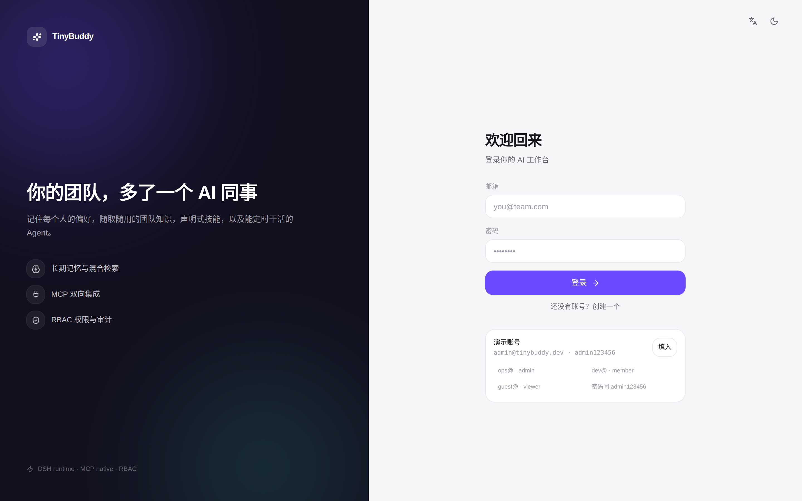

---

## Table of Contents

- [Why this exists](#why-this-exists)
- [Features](#features)
- [Screenshots](#screenshots)
- [Quick start](#quick-start)
- [Scripts](#scripts)
- [Architecture](#architecture)
- [Core design](#core-design)
- [MCP: client and server](#mcp-client-and-server)
- [Permissions](#permissions)
- [Configuration](#configuration)
- [Project layout](#project-layout)
- [FAQ](#faq)
- [Known limitations](#known-limitations)

---

## Why this exists

Most "AI assistants" stop at the chat box: every conversation starts from zero, they don't know your preferences, can't reach your documents, and can't call your internal tools.

TinyBuddy models the AI as a **team member**:

| Problem | TinyBuddy's answer |
| --- | --- |
| It forgets me | **Memory** — five memory kinds, hybrid retrieval, injected before every turn |
| It doesn't know our rules | **Knowledge base** — upload docs, chunk, retrieve, answer with citations |
| It can't do our work | **Skills** — declarative playbooks activated by trigger words |
| It can't reach our systems | **MCP client** — connect any MCP server, tools auto-injected |
| Other AIs can't reach it | **MCP server** — expose platform capabilities to Claude Desktop / Cursor |
| It only reacts | **Schedules** — cron runs a full agent turn as the task owner |
| I can't give it to colleagues | **RBAC** — 21 permissions, custom roles, scoped API keys, full audit trail |

---

## Features

| Module | Capability |
| --- | --- |
| **Chat agent** | SSE streaming, multi-step tool calling, memory recall, skill activation, cancellation, session history, Markdown rendering |
| **Memory** | 5 kinds (fact / preference / episode / procedure / entity); write-time dedup; hybrid scoring; manual CRUD + recall playground |
| **Skills** | Declarative packs (instructions + triggers + references + required tools); **progressive disclosure** injects only active skills |
| **Knowledge** | Multiple bases, heading-aware chunking, lexical + vector hybrid search, hits carry document name and score |
| **MCP client** | Streamable HTTP and SSE transports, automatic tool discovery |
| **MCP server** | 10 platform tools over standard MCP, API-key auth, scoped per key |
| **Schedules** | 5-field cron, timezone aware, run-now, execution history, results land in a dedicated session |
| **RBAC** | 4 built-in roles + custom roles, 21 permissions, one shared policy module, audit log |
| **Observability** | Run records (steps / tokens / latency), platform stats, audit trail |
| **UX** | Mobile-first responsive, EN/中文, light / dark / system theme |

---

## Screenshots

**Chat with tool calls** — the model calls `knowledge_search`, then streams the answer with cited sources.

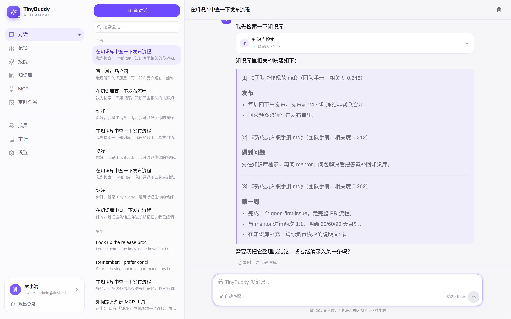

**Memory** — filter by kind, edit importance, run recall tests.

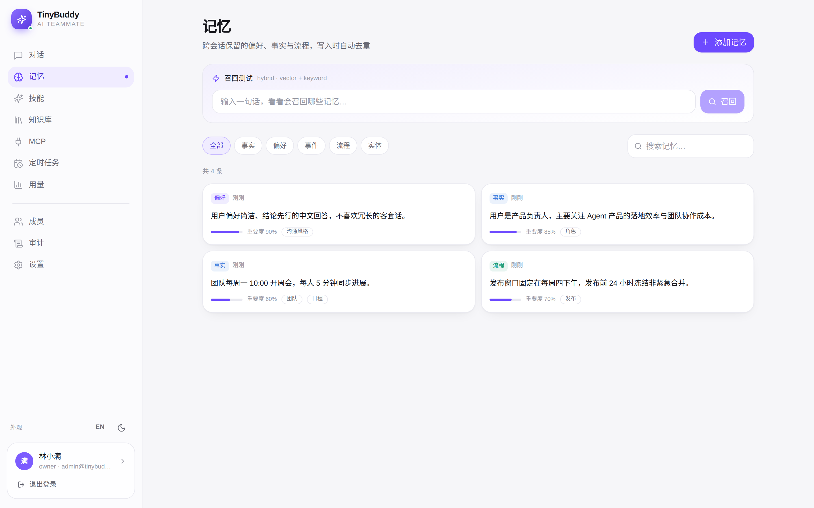

**Skills** — triggers decide activation; references are read on demand.

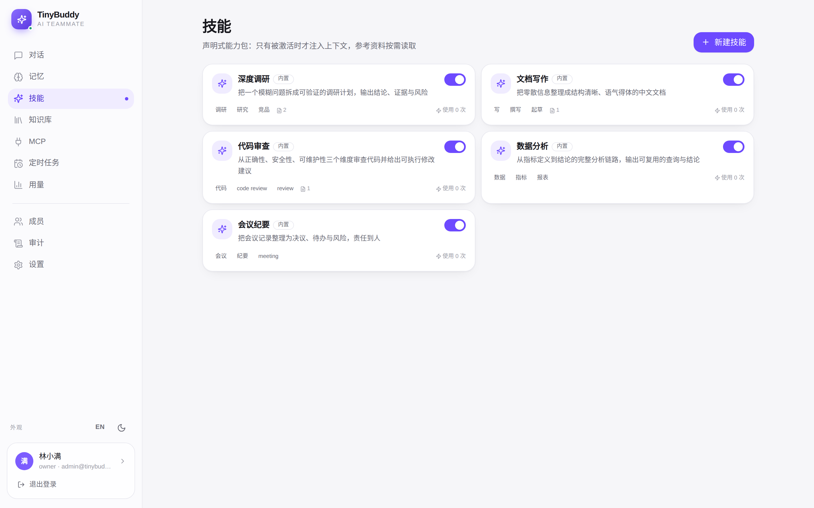

| Knowledge base | Schedules |
| --- | --- |
| 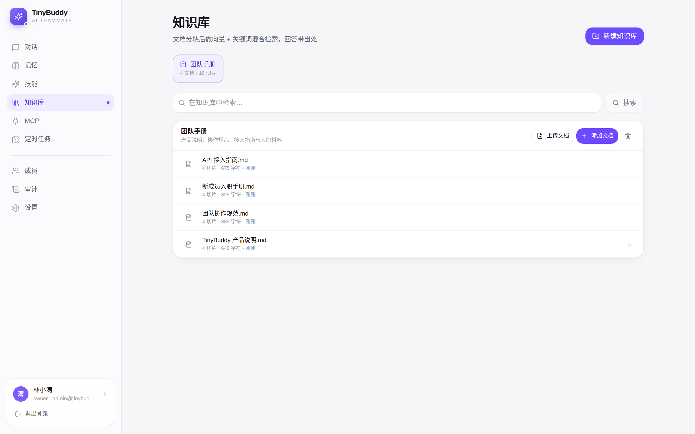 | 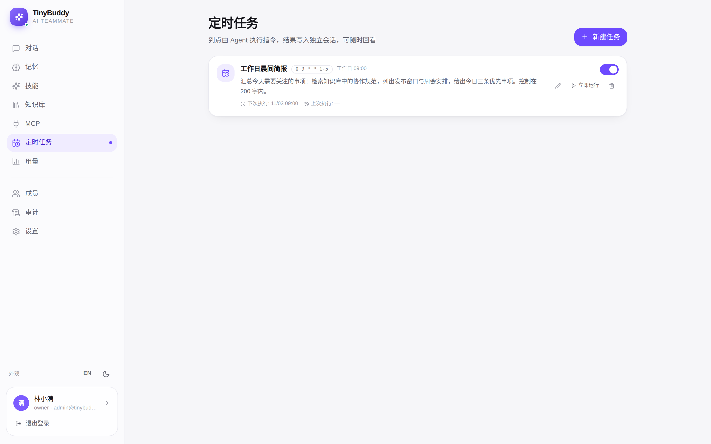 |

| Members and roles | Audit log |
| --- | --- |
| 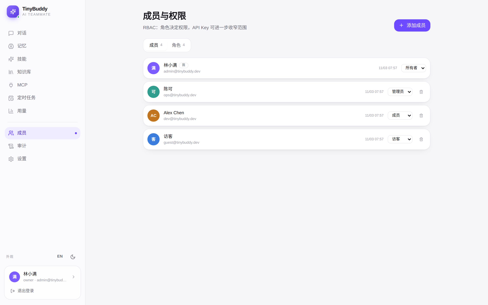 | 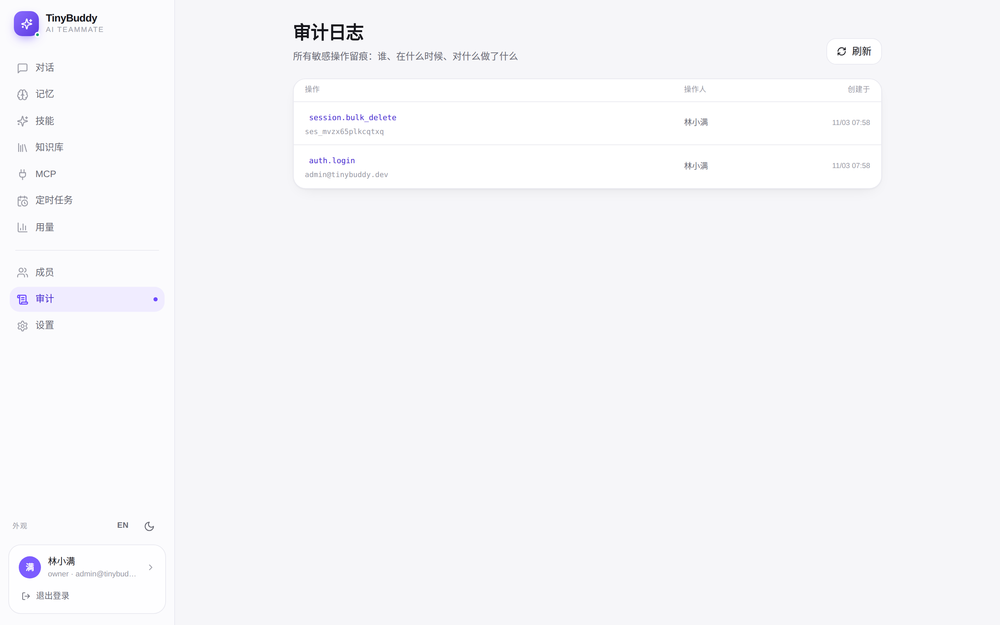 |

**MCP server** — copy-ready client config, API keys with narrowed scopes.

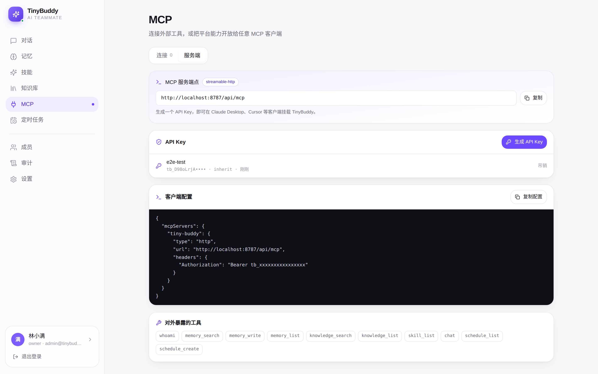

**Dark theme, English UI**

| Chat | Settings |
| --- | --- |
| 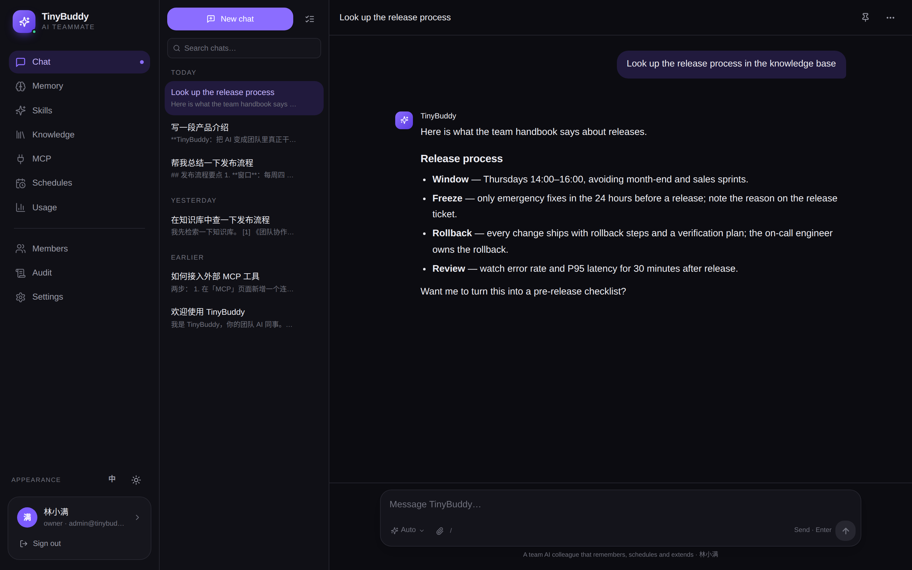 | 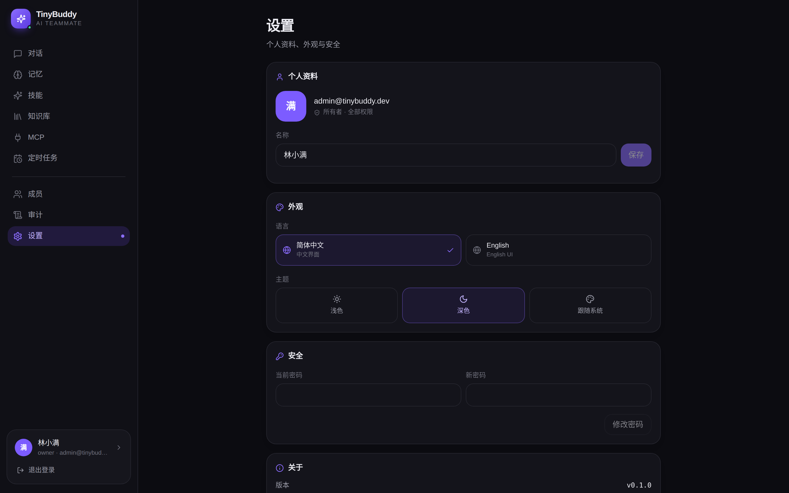 |

**Mobile**

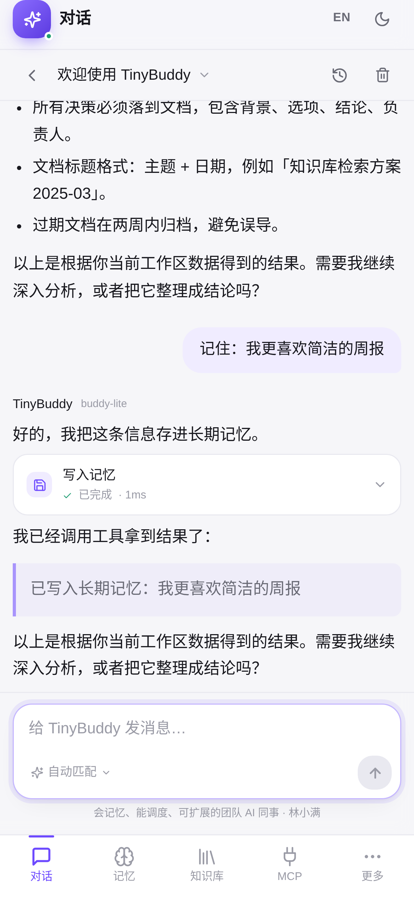 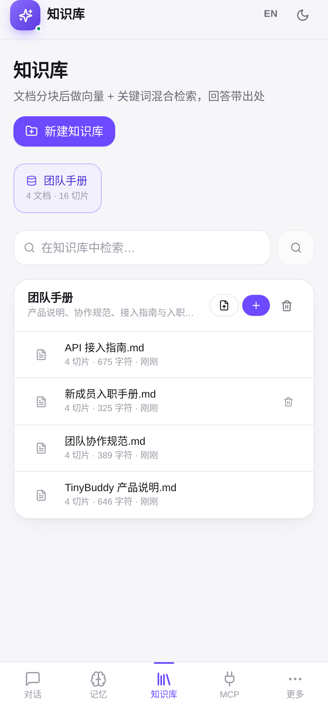 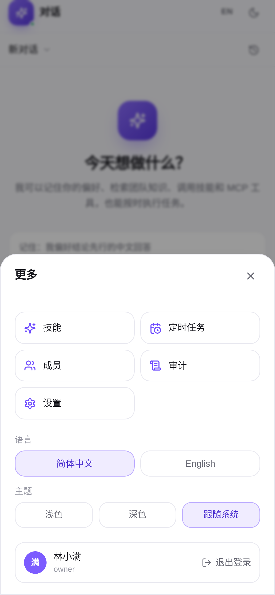

---

## Quick start

Requirements: **Node.js ≥ 20**, **pnpm ≥ 9**.

```bash
git clone https://github.com/<your-name>/tiny-buddy.git
cd tiny-buddy

pnpm install
pnpm dev          # server :8787 + web :5173 with HMR
```

Production mode (single port, the API server serves the SPA):

```bash
pnpm build
pnpm start        # http://localhost:8787
```

The first boot creates the schema and seeds demo data: 4 accounts (4 roles), 1 knowledge base (4 documents / 16 chunks), 5 skills, 5 memories, 1 schedule.

### Demo accounts

Password is `admin123456` for all of them.

| Account | Role | Can do |
| --- | --- | --- |
| `admin@tinybuddy.dev` | Owner | Everything, including platform admin |
| `ops@tinybuddy.dev` | Admin | Members, skills, knowledge, MCP |
| `dev@tinybuddy.dev` | Member | Chat, memory, knowledge, schedules |
| `guest@tinybuddy.dev` | Viewer | Read-only + chat |

> Seed data is written only when the database is empty. Delete `data/` to reset.

### Plug in a real model

By default the built-in `MockProvider` is used — **streaming, tool calls, memory writes and knowledge retrieval all really execute**; only the natural-language text is generated by local rules. Point these three variables at any OpenAI-compatible endpoint (DeepSeek / OpenAI / Qwen / vLLM / Ollama):

```bash
cp .env.example .env
# OPENAI_API_KEY=sk-xxx
# OPENAI_BASE_URL=https://api.deepseek.com/v1
# OPENAI_MODEL=deepseek-chat
```

The pipeline doesn't change — only the quality of the prose.

---

## Scripts

| Command | What it does |
| --- | --- |
| `pnpm dev` | Run server (8787) and web (5173, HMR) together |
| `pnpm build` / `pnpm start` | Build the SPA / run production on one port |
| `pnpm typecheck` | TypeScript check across the workspace |
| `pnpm seed` | Seed demo data without starting HTTP |
| `./scripts/tunnel.sh` | Expose the app through a Cloudflare quick tunnel |
| `pnpm --filter @tiny-buddy/server exec tsx scripts/test-mcp.ts` | MCP end-to-end self-test |

## Architecture

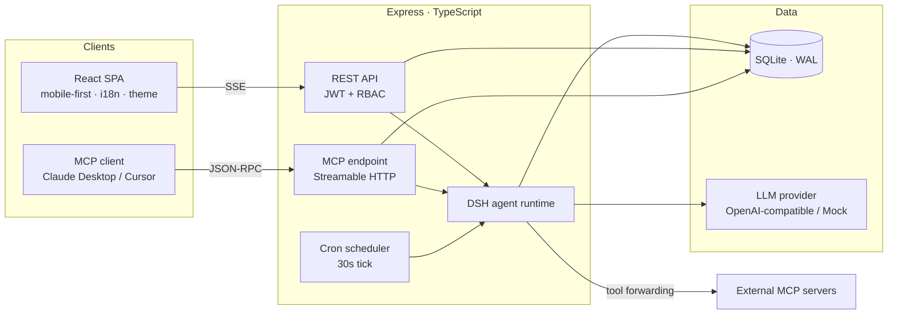

All three entry points share one agent runtime: **a human chatting in the browser**, **an external MCP client calling in**, and **a cron job running on its own** go through the same reasoning loop, the same memory and the same skills.

More in [docs/ARCHITECTURE.en.md](./docs/ARCHITECTURE.en.md).

---

## Core design

### DSH — an agent runtime you can lift out

`packages/dsh` has zero business dependencies. It only knows interfaces, not databases:

```ts
import { AgentRuntime, ToolRegistry, createProvider } from "@tiny-buddy/dsh";

const runtime = new AgentRuntime({
  provider,                                  // LlmProvider (streaming)
  tools,                                     // ToolRegistry
  config: { maxSteps: 6, skills, memory: { enabled: true, recallLimit: 5 } },
  memory: { recall },                        // MemoryPort
  knowledge: { search },                     // KnowledgePort
});

for await (const event of runtime.run({ runId, userId, sessionId, input })) {
  // run.start → skill.active → memory.recall → text.delta
  //           → tool.start → tool.end → message.end → run.end
}
```

Four properties that matter:

- **Reactive state** — run state lives in a `ReactiveStore`; `metrics` (steps, tokens, latency) can be subscribed to by any panel, no extra instrumentation.
- **Streaming first** — `run()` returns `AsyncIterable<AgentEvent>`, which maps directly onto SSE.
- **Progressive disclosure** — skill instructions enter the system prompt only when a trigger matches; references load via `skill_read`, keeping prompts small.
- **Cancellable** — `AbortSignal` flows down through every layer; model streams and tool calls stop immediately.

### Memory: dedup on write, hybrid retrieval on read

Before inserting, the new memory is compared against the 300 most recent ones. Identical content or cosine similarity > 0.94 counts as the same memory — timestamp and importance are updated instead of adding a duplicate.

Scoring:

```
score = 0.62 × lexical overlap + 0.30 × cosine(embedding) + 0.08 × importance
```

Lexical matching uses bigrams for Chinese. Embeddings are 128-dim hashed vectors — **no external dependency** — but they live in their own column, so swapping in a real embedding model doesn't touch the schema.

### Knowledge: chunk by heading, not by character count

Chunking breaks at Markdown headings first so each chunk stays semantically whole; oversized sections are split by paragraph and sentence, with the heading prepended so the retriever can still locate the topic.

Scoring reuses the hybrid formula, plus a heading bonus (if the query terms appear in the section title, that section is probably the answer), and drops anything below `0.08`.

Measured on the seeded corpus:

| Query | Top-1 hit | Score |
| --- | --- | --- |
| 发布流程 (release process) | 《团队协作规范 · 发布》 | 0.43 |
| 周会 (weekly sync) | 《团队协作规范 · 沟通》 | 0.73 |
| 密码策略 (password policy) | 《信息安全规范 · 账号与密码》 | 0.52 |

### Schedules run as their owner

When cron fires, the scheduler builds an agent run using **the task owner's identity** and writes the result into a dedicated session. You open the web app and see what it did overnight — no log digging.

---

## MCP: client and server

### As a client

Add a server under "MCP → Connections". Two transports:

| Transport | When to use |
| --- | --- |
| `http` | Streamable HTTP (recommended, MCP 2025-06-18) |
| `sse` | Legacy HTTP+SSE for older servers |

Tools are discovered on connect and registered as `mcp__<server>__<tool>` in the agent's toolbox.

### As a server

Ten platform capabilities are exposed over standard MCP:

| Tool | Purpose |
| --- | --- |
| `whoami` | Current identity and permissions |
| `memory_search` / `memory_list` / `memory_write` | Search, list, write memories |
| `knowledge_search` / `knowledge_list` | Search knowledge, list bases |
| `skill_list` | Available skills |
| `chat` | Run a full agent turn |
| `schedule_list` / `schedule_create` | List and create schedules |

Client config (copy-ready in the UI, API key pre-filled):

```json
{
  "mcpServers": {
    "tiny-buddy": {
      "type": "http",
      "url": "https://your-domain.com/api/mcp",
      "headers": { "Authorization": "Bearer tb_xxxxxxxxxxxx" }
    }
  }
}
```

Authentication uses API keys (`Authorization: Bearer tb_...`). A key may declare a subset of scopes; the effective permission is the **intersection** with the user's permissions — narrowing only, never widening.

An end-to-end script connects to this very server using the official SDK:

```bash
pnpm --filter @tiny-buddy/server exec tsx scripts/test-mcp.ts
```

It exercises `initialize → tools/list (10) → whoami → memory_search → memory_write → knowledge_search → skill_list → schedule_list → chat`.

See [docs/MCP.en.md](./docs/MCP.en.md).

---

## Permissions

Permissions follow `resource:action` — 21 of them, e.g. `memory:read`, `mcp:write`, `platform:admin`.

The policy lives in `packages/shared/src/rbac.ts` and is **shared by both sides**:

- the front end hides menus and buttons it can't use;
- the back end enforces with `requirePermission()`.

> Hiding is a UX nicety. **The server never trusts the client.** Verified: a `member` hitting `/api/users` gets 403.

Built-in roles:

| Role | Scope |
| --- | --- |
| Owner | `*` |
| Admin | Everything except `platform:admin` |
| Member | Chat, memory, knowledge, schedules (own data) |
| Viewer | Read-only + chat |

Custom roles can be created from "Members → Roles" by ticking permissions. Sensitive operations (login, member changes, key creation, MCP connections, scheduled runs) are written to `audit_logs`.

---

## Configuration

Full template in [`.env.example`](./.env.example).

| Variable | Default | Description |
| --- | --- | --- |
| `PORT` | `8787` | Server port |
| `HOST` | `0.0.0.0` | Bind address |
| `DATABASE_FILE` | `./data/tiny-buddy.db` | SQLite file |
| `JWT_SECRET` | auto | Generated and persisted to `data/.jwt-secret` when empty |
| `PUBLIC_URL` | `http://localhost:8787` | Used when generating MCP client config |
| `OPENAI_API_KEY` | empty | Empty → offline demo provider |
| `OPENAI_BASE_URL` | `https://api.deepseek.com/v1` | Any OpenAI-compatible endpoint |
| `OPENAI_MODEL` | `deepseek-chat` | Model name |
| `ALLOW_REGISTER` | `true` | Enable self-service signup |

---

## Project layout

```
tiny-buddy/
├── packages/
│   ├── shared/                 # Domain types, RBAC, agent event contract (shared by both sides)
│   ├── dsh/                    # Reactive agent runtime (zero business deps)
│   │   ├── reactive.ts         # Signal / ReactiveStore / AsyncQueue
│   │   ├── tools.ts            # ToolRegistry (platform / MCP / skill — one contract)
│   │   ├── provider.ts         # OpenAI-compatible streaming + local mock
│   │   ├── prompt.ts           # System prompt assembly (skills / memory / knowledge)
│   │   └── runtime.ts          # Multi-step loop and event stream
│   └── server/
│       ├── db/                 # Schema (15 tables) + idempotent seed
│       ├── lib/                # Auth, RBAC middleware, cron, tokenizer / vectors / chunking
│       ├── services/           # memory / knowledge / skills / mcp / mcpServer / scheduler / agent
│       └── routes/             # REST resources
└── apps/web/src/
    ├── lib/                    # api · SSE parser · i18n · theme · auth · toast · format
    ├── components/             # Layout (sidebar + bottom nav), UI primitives
    └── pages/                  # Chat / Memory / Skills / Knowledge / MCP / Schedules / Members / Audit / Settings
```

---

## FAQ

**How far can I get without an API key?**
Everything runs: streaming, tool calls, memory writes and recall, knowledge search, schedules, MCP interop. Only the prose is rule-generated, and the UI labels it as demo mode.

**Can I switch to Postgres?**
Yes. All SQL is confined to `db/` and `services/`. Replace `better-sqlite3` with `pg` and adjust the few synchronous call sites.

**What about multi-instance deployments?**
The MCP endpoint is stateless and scales horizontally. Schedules currently use an in-process 30-second tick, so multi-instance setups need a distributed lock or a dedicated worker (see limitations).

**Do the SPA route `/mcp` and the MCP endpoint collide?**
No. `POST /mcp` and `POST /api/mcp` go to the MCP handler; `GET /mcp` is only treated as MCP when `Accept: text/event-stream`, otherwise it falls through to the SPA router.

---

## Known limitations

- Document ingestion supports plain text only (`.md` / `.txt` / `.json`); PDF/Word must be converted first.
- Vectors are locally hashed — weaker semantic generalization than real embeddings.
- Schedules use in-process polling; multi-instance deployments need distributed scheduling.
- The MCP server supports API keys / JWT only; no OAuth flow yet.

## Stack

TypeScript 5 · Node 20+ · Express 4 · better-sqlite3 · React 18 · Vite 6 · Tailwind CSS 3 · `@modelcontextprotocol/sdk` 1.x · Zod

## License

[MIT](./LICENSE)
