# TinyBuddy

[](https://github.com/liudonghua123/tiny-buddy/actions/workflows/ci.yml)
[](./LICENSE)
[](https://www.typescriptlang.org/)
[](./package.json)

**一个可以直接跑起来的「AI 同事」平台。** TypeScript 全栈 B/S 架构，自带记忆、技能、知识库、MCP 双向通道与定时任务，权限体系基于 RBAC，并且能把平台能力以标准 MCP 服务对外开放。

[English](./README.en.md) · [变更记录](./CHANGELOG.md) · [文档索引](./docs/README.md) · [架构](./docs/ARCHITECTURE.md) · [API](./docs/API.md) · [MCP](./docs/MCP.md) · [部署](./docs/DEPLOYMENT.md)

仓库：<https://github.com/liudonghua123/tiny-buddy> · 在线演示：<https://peak-enrolled-kingdom-winston.trycloudflare.com>

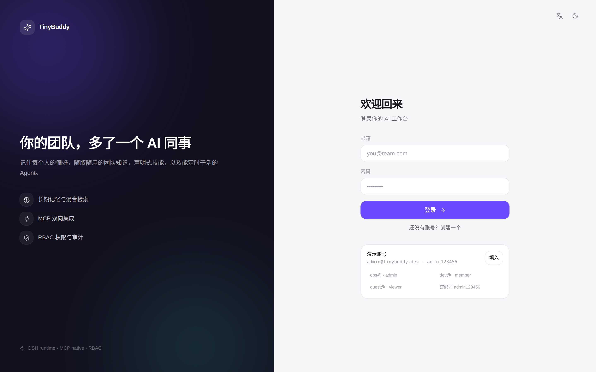

---

## 目录

- [它解决什么问题](#它解决什么问题)
- [功能一览](#功能一览)
- [界面截图](#界面截图)
- [快速开始](#快速开始)
- [常用脚本](#常用脚本)
- [架构总览](#架构总览)
- [核心设计](#核心设计)
- [MCP：既是客户端，也是服务端](#mcp既是客户端也是服务端)
- [权限模型](#权限模型)
- [配置项](#配置项)
- [项目结构](#项目结构)
- [常见问题](#常见问题)
- [已知限制](#已知限制)

---

## 它解决什么问题

大多数「AI 助手」停在对话框：每次对话从零开始，不知道你的偏好，够不到你的资料，也接不进你的工具。

TinyBuddy 把 AI 当成一个**团队成员**来建模：

| 问题 | TinyBuddy 的答案 |
| --- | --- |
| 它记不住我 | **记忆**：五类记忆 + 混合检索，对话前自动召回相关上下文 |
| 它不懂我们的规范 | **知识库**：上传文档 → 分块 → 检索，回答带出处 |
| 它不会干我们的活 | **技能**：把「怎么做一件事」写成声明式技能包，按需激活 |
| 它够不到我们的系统 | **MCP 客户端**：接入任意 MCP 服务，工具自动进入 Agent 工具箱 |
| 别的 AI 够不到它 | **MCP 服务端**：把平台能力以 MCP 协议开放给 Claude Desktop / Cursor |
| 它只会被动回答 | **定时任务**：cron 触发，以创建者身份自主跑完一个任务 |
| 不敢给同事用 | **RBAC**：21 个权限点、自定义角色、API Key 收窄、全量审计 |

---

## 功能一览

| 模块 | 能力 |
| --- | --- |
| **对话 Agent** | SSE 流式输出、多步工具调用、记忆召回、技能激活、随时中断、重新生成、消息复制、会话搜索与按日分组、代码块复制、Markdown 渲染 |
| **记忆 Memory** | 5 类记忆（事实 / 偏好 / 事件 / 流程 / 实体）；写入自动去重；混合检索打分；手动增删改 + 召回测试台 |
| **技能 Skill** | 声明式能力包（指令 + 触发词 + 参考资料 + 所需工具）；**渐进式披露**，只注入被激活技能的指令 |
| **知识库 Knowledge** | 多知识库、Markdown 章节级分块、词法 + 向量混合检索、命中片段带文档名与得分 |
| **MCP 客户端** | 支持 Streamable HTTP / SSE 两种传输，连接后自动发现工具并注入 Agent |
| **MCP 服务端** | 平台 10 个能力以标准 MCP 暴露，API Key 鉴权，可挂载到任何 MCP 客户端 |
| **定时任务** | 5 段 cron、时区感知、立即触发、执行历史、结果落到独立会话 |
| **RBAC** | 4 个内置角色 + 自定义角色、21 个权限点、前后端同一份判定逻辑、全量审计日志 |
| **可观测** | Run 记录（步数 / token / 耗时）、平台统计、审计日志 |
| **体验** | 移动端优先响应式、中英双语、浅色 / 深色 / 跟随系统 |

---

## 界面截图

**对话 + 工具调用**（模型自主调用 `knowledge_search` 检索知识库，流式输出结论并标注出处）

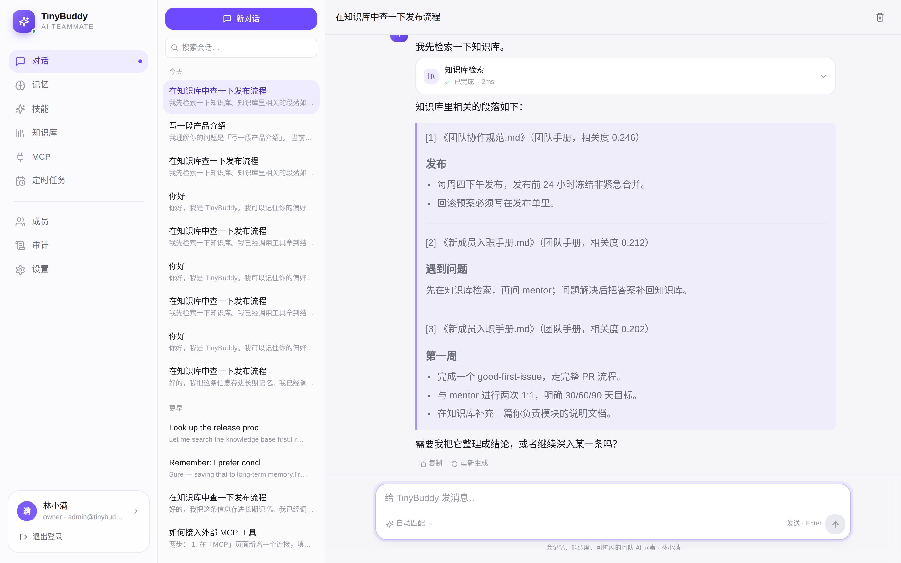

**记忆管理**：左侧按类型筛选，右侧可手动新增、调整重要度、跑召回测试

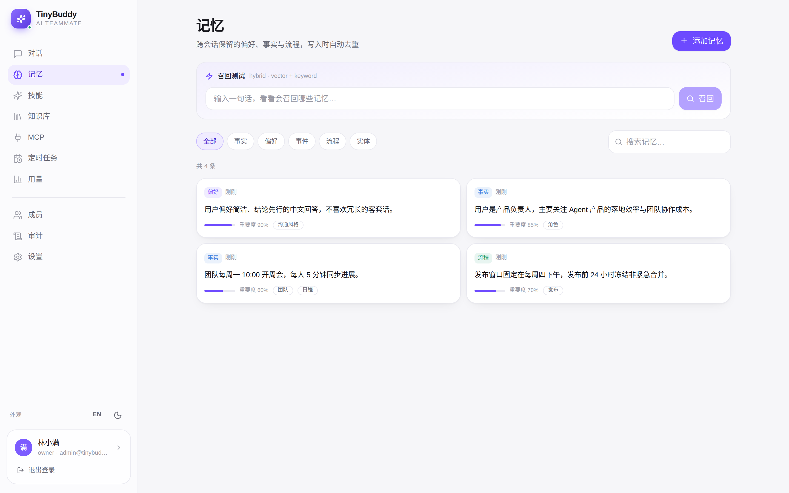

**技能**：声明式配置，触发词决定何时激活，参考资料按需读取

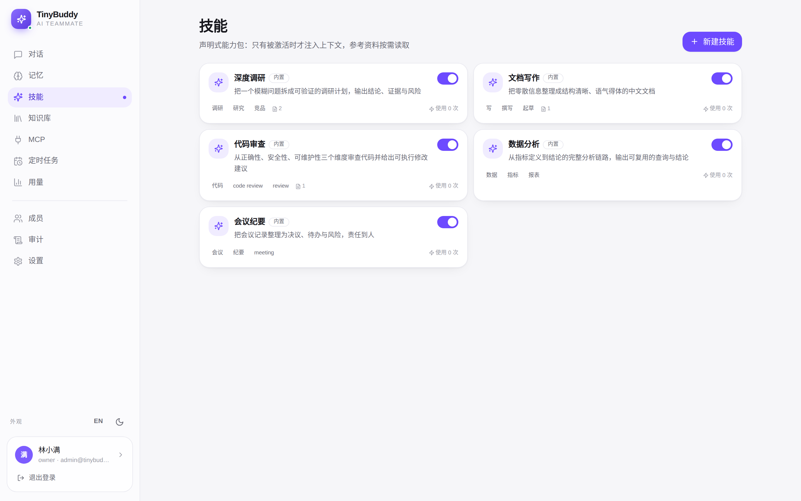

| 知识库 | 定时任务 |
| --- | --- |
| 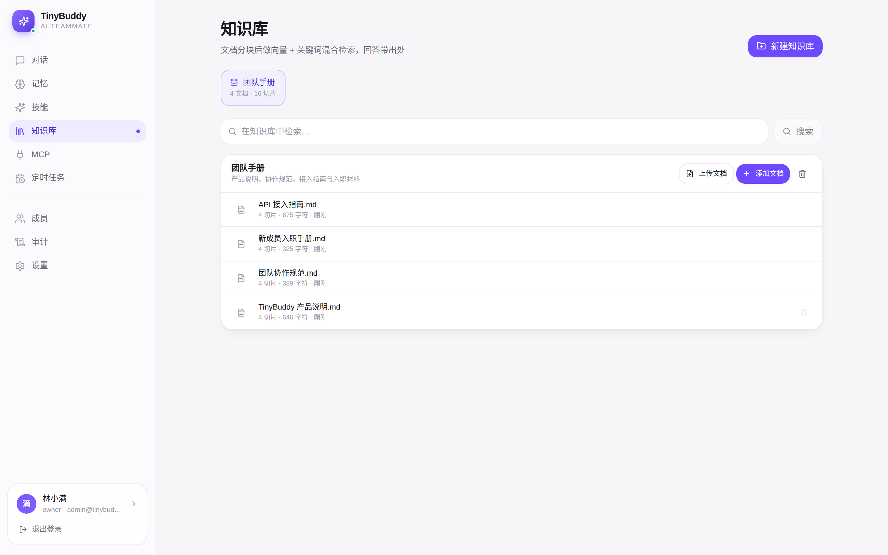 | 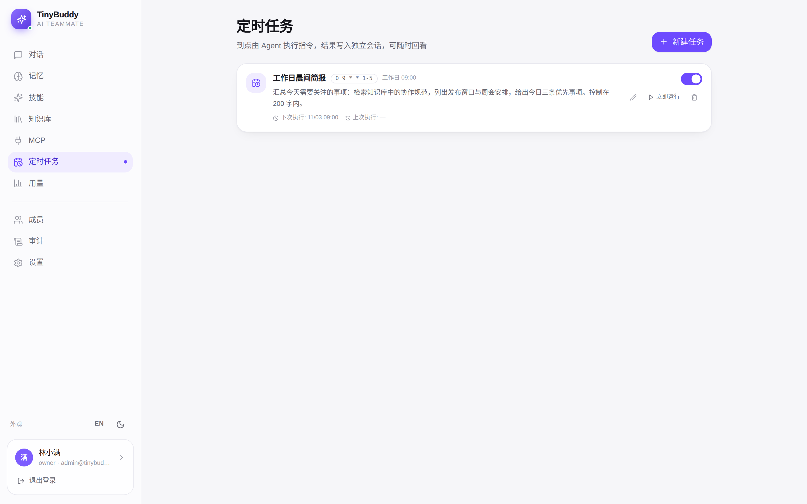 |

**会话搜索与按日分组**（会话变多后仍能快速定位）

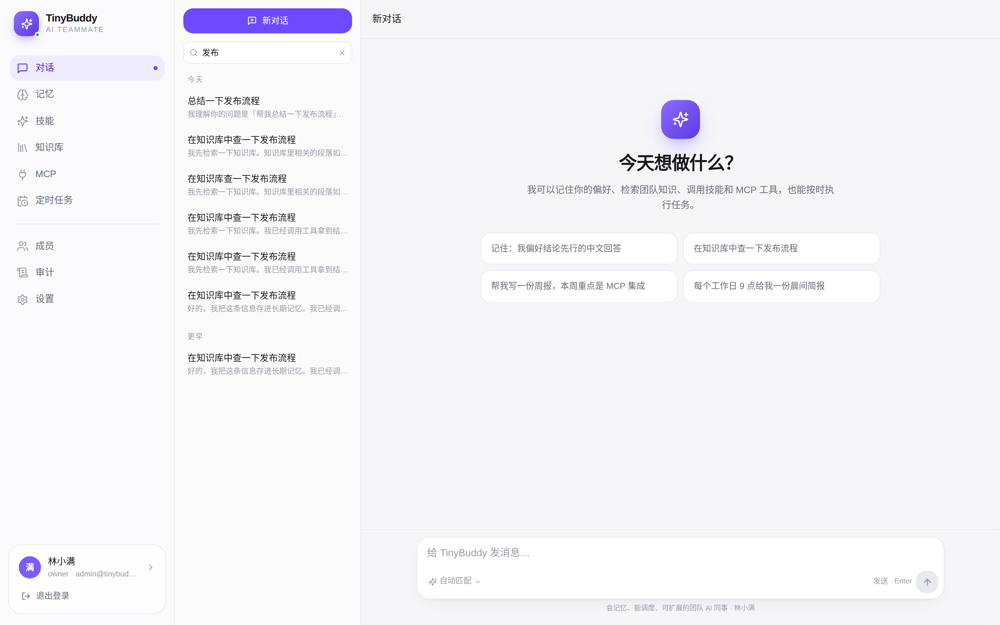

| 成员与角色 | 审计日志 |
| --- | --- |
| 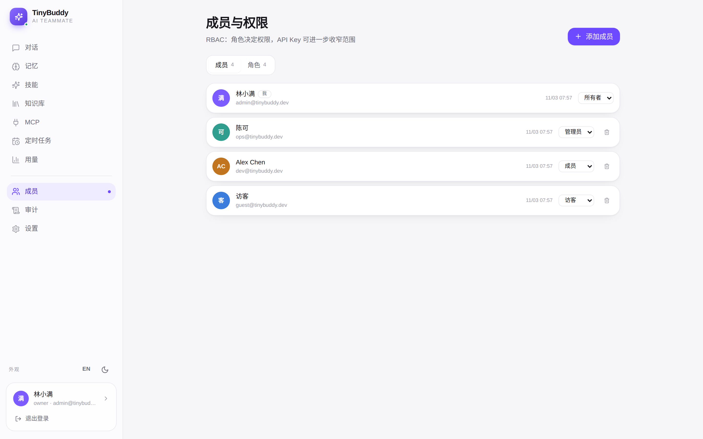 | 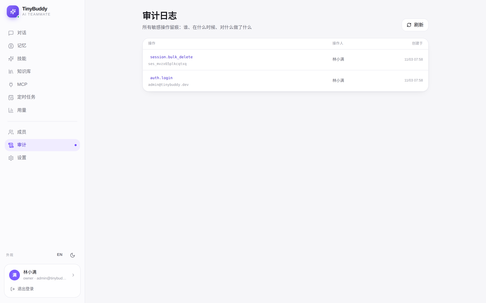 |

**MCP 服务端**：一键生成客户端配置，API Key 可二次收窄权限

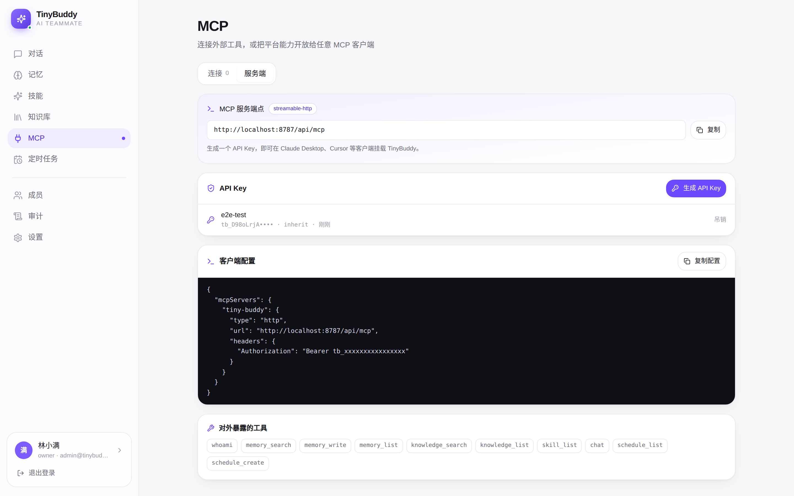

**深色主题 + 英文界面**

| 对话 | 设置 |
| --- | --- |
| 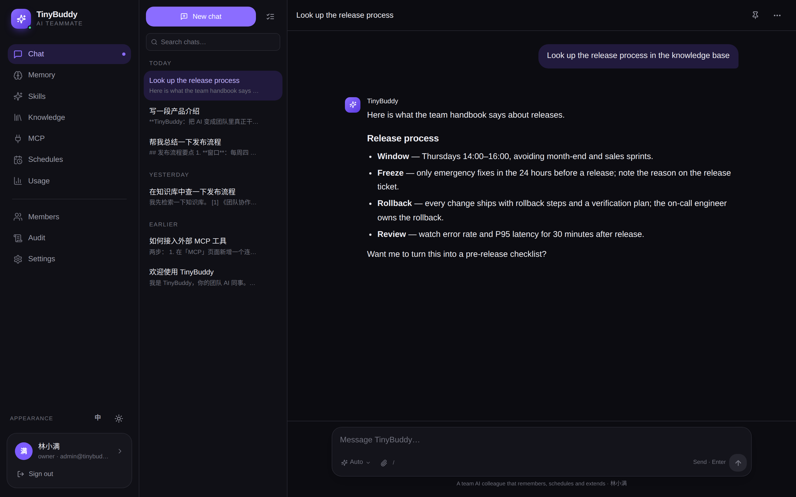 | 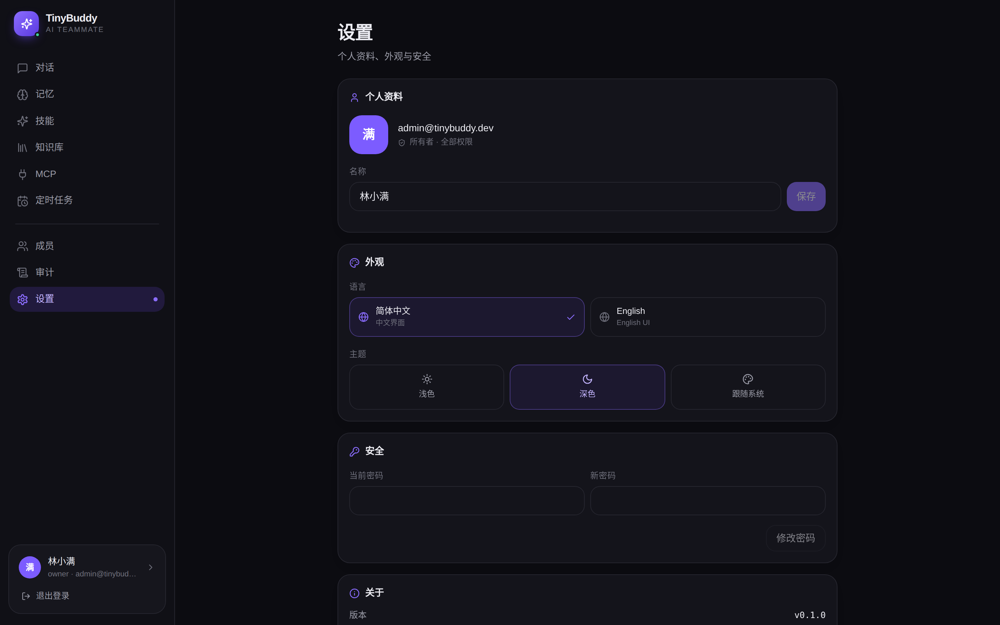 |

**移动端**（底部导航 + 全屏对话）

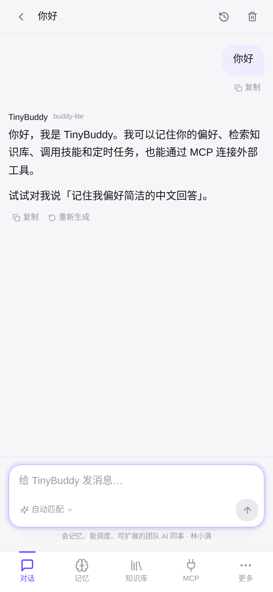 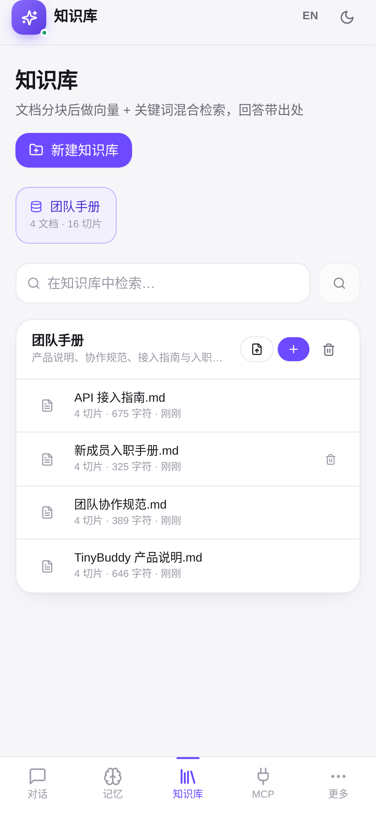 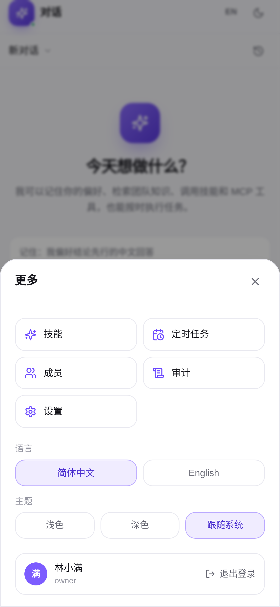

---

## 快速开始

环境要求：**Node.js ≥ 20**、**pnpm ≥ 9**。

```bash
git clone https://github.com/<your-name>/tiny-buddy.git
cd tiny-buddy

pnpm install
pnpm dev          # server :8787 + web :5173（热更新）
```

或者用生产模式（单端口，后端直接托管前端静态资源）：

```bash
pnpm build
pnpm start        # http://localhost:8787
```

首次启动会自动建库，并写入演示数据：4 个账号（4 种角色）、1 个知识库（4 篇文档 / 16 个分块）、5 个技能、5 条记忆、1 个定时任务。

### 演示账号

密码统一为 `admin123456`。

| 账号 | 角色 | 能做什么 |
| --- | --- | --- |
| `admin@tinybuddy.dev` | Owner | 全部功能，含平台管理 |
| `ops@tinybuddy.dev` | Admin | 成员、技能、知识、MCP 管理 |
| `dev@tinybuddy.dev` | Member | 对话 / 记忆 / 知识 / 定时任务 |
| `guest@tinybuddy.dev` | Viewer | 只读 + 对话 |

> 演示数据只在数据库为空时写入一次，删除 `data/` 目录即可重置。

### 接入真实模型

默认走内置 `MockProvider`——**流式输出、工具调用、记忆写入、知识检索全部真实执行**，只有自然语言文本由本地规则生成。配置下面三项即可切换到任意 OpenAI 兼容模型（DeepSeek / OpenAI / Qwen / vLLM / Ollama）：

```bash
cp .env.example .env
# OPENAI_API_KEY=sk-xxx
# OPENAI_BASE_URL=https://api.deepseek.com/v1
# OPENAI_MODEL=deepseek-chat
```

链路完全不变，只是文本质量换了一个档位。

---

## 常用脚本

| 命令 | 作用 |
| --- | --- |
| `pnpm dev` | 同时启动 server（8787）与 web（5173，HMR） |
| `pnpm build` / `pnpm start` | 构建前端 / 单端口生产运行 |
| `pnpm typecheck` | 全仓库 TypeScript 检查 |
| `pnpm seed` | 只写演示数据，不启动 HTTP |
| `./scripts/tunnel.sh` | 用 Cloudflare 快速隧道暴露到公网 |
| `pnpm --filter @tiny-buddy/server exec tsx scripts/test-mcp.ts` | MCP 端到端自测 |

## 架构总览

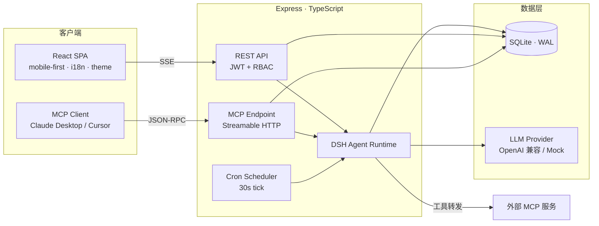

三条入口共用同一个 Agent 运行时：**人在网页里聊**、**外部 MCP 客户端调**、**定时任务自己跑**，走的是同一条推理循环、同一套记忆与技能。

详细设计见 [docs/ARCHITECTURE.md](./docs/ARCHITECTURE.md)。

---

## 核心设计

### DSH：一个可以单独拎走的 Agent 运行时

`packages/dsh` 是零业务依赖的响应式 Agent 框架，只认接口、不认识数据库：

```ts
import { AgentRuntime, ToolRegistry, createProvider } from "@tiny-buddy/dsh";

const runtime = new AgentRuntime({
  provider,                                  // LlmProvider（流式）
  tools,                                     // ToolRegistry
  config: { maxSteps: 6, skills, memory: { enabled: true, recallLimit: 5 } },
  memory: { recall },                        // MemoryPort
  knowledge: { search },                     // KnowledgePort
});

for await (const event of runtime.run({ runId, userId, sessionId, input })) {
  // run.start → skill.active → memory.recall → text.delta
  //           → tool.start → tool.end → message.end → run.end
}
```

四个关键点：

- **响应式状态**：运行状态放在 `ReactiveStore`，`metrics`（步数、token、耗时）可被任意面板订阅，不需要额外埋点；
- **流式优先**：`run()` 直接返回 `AsyncIterable<AgentEvent>`，天然对接 SSE，无需适配层；
- **渐进式披露**：技能指令只在触发词命中或显式指定时进入 system prompt，参考文档通过 `skill_read` 按需读取，避免 prompt 膨胀；
- **可中断**：`AbortSignal` 逐层下传，模型流与工具执行都能立即停下。

### 记忆：先查重，再召回

写入前与最近 300 条比对：内容完全相同或余弦相似度 > 0.94 视为同一条记忆，只更新时间与重要度，避免「复读机式」堆积。

召回打分：

```
score = 0.62 × 词法重合 + 0.30 × 向量余弦 + 0.08 × 重要度
```

词法部分对中文做了 bigram 切分，向量是 128 维哈希向量——**零外部依赖**，但 `embedding` 字段是独立列，将来换真实 embedding 模型不用改表结构。

### 知识库：按章节切，而不是按字数切

分块优先在 Markdown 标题处断开，让每个 chunk 保持语义完整；超长章节再按段落、句子切，并在子块前保留章节标题，检索时更容易命中主题。

打分公式与记忆一致，额外给标题命中加权（章节标题里出现查询词，说明这一节大概率就是答案），并用 `score > 0.08` 过滤噪声。

实测（内置演示文档）：

| 查询 | Top-1 命中 | 得分 |
| --- | --- | --- |
| 发布流程 | 《团队协作规范 · 发布》 | 0.43 |
| 周会 | 《团队协作规范 · 沟通》 | 0.73 |
| 密码策略 | 《信息安全规范 · 账号与密码》 | 0.52 |

### 定时任务：以创建者身份运行

cron 到点后，调度器用**任务创建者的身份**构造一次 Agent 运行，结果写入该任务的独立会话——你打开网页就能看到它昨晚干了什么，而不是去翻日志。

---

## MCP：既是客户端，也是服务端

### 作为客户端

页面「MCP → 连接」添加服务，支持两种传输：

| 传输 | 场景 |
| --- | --- |
| `http` | Streamable HTTP（MCP 2025-06-18 推荐） |
| `sse` | 旧版 HTTP+SSE，兼容早期服务 |

连接后自动拉取工具列表，以 `mcp__<server>__<tool>` 命名注入 Agent 工具箱，模型可直接调用。

### 作为服务端

平台把 10 个能力以标准 MCP 暴露出去：

| 工具 | 说明 |
| --- | --- |
| `whoami` | 当前身份与权限 |
| `memory_search` / `memory_list` / `memory_write` | 记忆检索、列举、写入 |
| `knowledge_search` / `knowledge_list` | 知识检索、知识库列表 |
| `skill_list` | 可用技能 |
| `chat` | 触发一次完整 Agent 对话 |
| `schedule_list` / `schedule_create` | 查看、创建定时任务 |

客户端配置（在页面里可一键复制，API Key 会自动填好）：

```json
{
  "mcpServers": {
    "tiny-buddy": {
      "type": "http",
      "url": "https://your-domain.com/api/mcp",
      "headers": { "Authorization": "Bearer tb_xxxxxxxxxxxx" }
    }
  }
}
```

鉴权用 API Key（`Authorization: Bearer tb_...`），Key 可以只勾选部分 scopes，与用户权限取交集——**收窄，绝不放宽**。

仓库内附带端到端验证脚本，用官方 SDK 作为客户端连自己的服务：

```bash
pnpm --filter @tiny-buddy/server exec tsx scripts/test-mcp.ts
```

输出会依次验证 `initialize → tools/list（10 个）→ whoami → memory_search → memory_write → knowledge_search → skill_list → schedule_list → chat`。

细节见 [docs/MCP.md](./docs/MCP.md)。

---

## 权限模型

权限点按 `资源:动作` 组织，共 21 个，例如 `memory:read`、`mcp:write`、`platform:admin`。

判定逻辑在 `packages/shared/src/rbac.ts`——**前后端共用同一份实现**：

- 前端用它决定菜单与按钮是否出现；
- 后端 `requirePermission()` 中间件强制校验。

> 前端隐藏只是体验优化，**后端永远不信任前端**。实测：`member` 账号访问 `/api/users` 返回 403。

四个内置角色：

| 角色 | 权限范围 |
| --- | --- |
| Owner | `*` 全部 |
| Admin | 除 `platform:admin` 外全部 |
| Member | 对话、记忆、知识、定时任务（只读 + 写自己的） |
| Viewer | 只读 + 对话 |

角色可自定义：在「成员 → 角色」里勾选权限点即可创建新角色。所有敏感操作（登录、成员变更、Key 创建、MCP 连接、定时任务触发）都会写入 `audit_logs`。

---

## 配置项

完整模板见 [`.env.example`](./.env.example)。

| 变量 | 默认值 | 说明 |
| --- | --- | --- |
| `PORT` | `8787` | 服务端口 |
| `HOST` | `0.0.0.0` | 监听地址 |
| `DATABASE_FILE` | `./data/tiny-buddy.db` | SQLite 文件位置 |
| `JWT_SECRET` | 自动生成 | 留空则生成并持久化到 `data/.jwt-secret` |
| `PUBLIC_URL` | `http://localhost:8787` | 生成 MCP 配置时使用的公网地址 |
| `OPENAI_API_KEY` | 空 | 留空 → 离线演示模型 |
| `OPENAI_BASE_URL` | `https://api.deepseek.com/v1` | 任意 OpenAI 兼容端点 |
| `OPENAI_MODEL` | `deepseek-chat` | 模型名 |
| `ALLOW_REGISTER` | `true` | 是否开放自助注册 |

---

## 项目结构

```
tiny-buddy/
├── packages/
│   ├── shared/                 # 领域类型、RBAC、Agent 事件契约（前后端共用）
│   ├── dsh/                    # 响应式 Agent 运行时（零业务依赖）
│   │   ├── reactive.ts         # Signal / ReactiveStore / AsyncQueue
│   │   ├── tools.ts            # ToolRegistry（平台 / MCP / 技能统一契约）
│   │   ├── provider.ts         # OpenAI 兼容流式 + 本地 Mock
│   │   ├── prompt.ts           # system prompt 组装（技能 / 记忆 / 知识）
│   │   └── runtime.ts          # 多步推理循环、事件流
│   └── server/
│       ├── db/                 # schema（15 张表）+ 幂等种子数据
│       ├── lib/                # 鉴权、RBAC 中间件、cron、分词 / 向量 / 分块
│       ├── services/           # memory / knowledge / skills / mcp / mcpServer / scheduler / agent
│       └── routes/             # REST 资源（auth · sessions · chat · memory · skills · knowledge · mcp · schedules · keys · users · roles · admin）
└── apps/web/src/
    ├── lib/                    # api · SSE 解析 · i18n · theme · auth · toast · format
    ├── components/             # Layout（侧栏 + 底部导航）、UI 基件
    └── pages/                  # Chat / Memory / Skills / Knowledge / MCP / Schedules / Members / Audit / Settings
```

---

## 常见问题

**Q：没有 API Key 能体验到什么程度？**
全套功能都能跑：流式输出、工具调用、记忆写入与召回、知识检索、定时任务、MCP 协议互通。只有回答文本是本地规则生成的，会明确标注「演示模式」。

**Q：能换成 Postgres 吗？**
可以。数据访问集中在 `db/` 与 `services/`，两者之外没有任何 SQL。把 `better-sqlite3` 换成 `pg` 并调整少量同步调用即可。

**Q：多实例部署要注意什么？**
MCP 端点是无状态的，可以水平扩展；但定时任务目前是进程内 30 秒轮询，多实例需要换成分布式锁或独立 worker（见 [已知限制](#已知限制)）。

**Q：前端页面和后端的 `/mcp` 端点路径冲突吗？**
不冲突。`POST /mcp` 与 `POST /api/mcp` 交给 MCP 处理器；`GET /mcp` 只有在 `Accept: text/event-stream` 时才按 MCP 处理，浏览器访问会落到前端路由。

---

## 已知限制

- 文档解析仅支持纯文本类（`.md` / `.txt` / `.json`），PDF / Word 需先转文本；
- 向量为本地哈希实现，语义泛化弱于真实 embedding 模型；
- 定时任务为进程内轮询，多实例需改分布式调度；
- MCP 服务端只支持 API Key / JWT，未实现 OAuth 授权流程。

## 技术栈

TypeScript 5 · Node 20+ · Express 4 · better-sqlite3 · React 18 · Vite 6 · Tailwind CSS 3 · `@modelcontextprotocol/sdk` 1.x · Zod

## 许可证

[MIT](./LICENSE)
